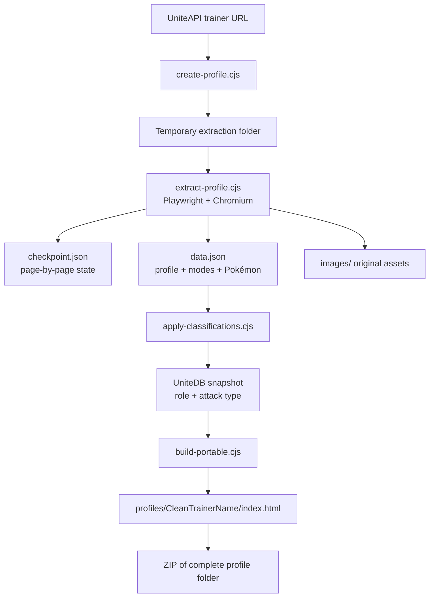
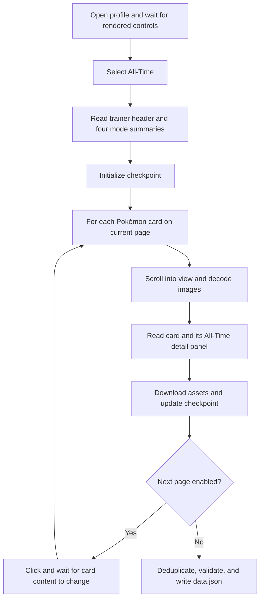
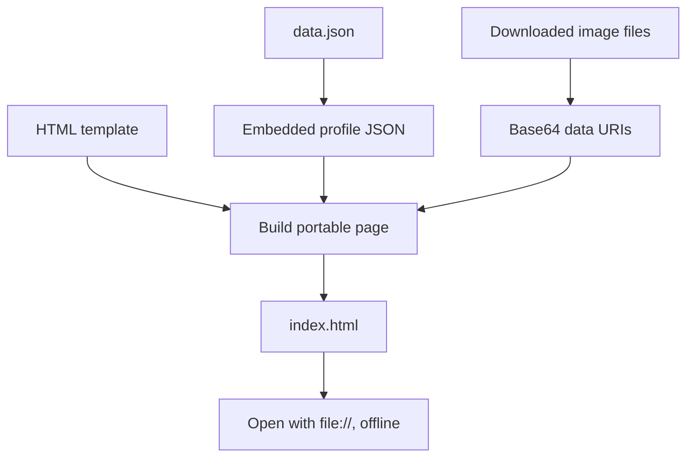

# Pokémon UNITE Trainer Profile Infographics

## Project overview

This workspace turns public trainer profiles on UniteAPI into reusable, self-contained infographics. The project captures visible trainer metadata and All-Time mode summaries, walks every Pokémon Stats page, records each Pokémon's card and build, stores original image assets, applies role and attack-type classifications, and generates a portable HTML page.

The work was developed iteratively on **November 26, 2026**. Each profile is a timestamped snapshot: UniteAPI statistics can change after extraction, so the figures below describe the captured profiles, not permanent account values.

## Origin: initial problem and fatal workflow error

The first conversation established the actual job: read a rendered UniteAPI trainer profile, select **All-Time**, capture the four mode summaries, traverse an unknown number of Pokémon pages, collect each Pokémon's All-Time figures and build images, save progress to the workspace as extraction proceeds, validate counts/assets, and then make a portable infographic. The initial profile was expected to have 24 pages and 97 unique Pokémon, but the workflow also had to support different totals on later profiles.

The first attempt failed before it could meet those requirements. It used a `data:` URL to prepare a browser download. The browser rejected that URL and explicitly said not to reproduce the same outcome through another surface or method. At that point there was no confirmed workflow that could both inspect the rendered page and write page-by-page checkpoints and images directly into the workspace. **That was the fatal error:** the selected transfer mechanism was blocked, and the remaining handoff path could not satisfy the project's persistence requirement. It was a workflow/tooling failure, not evidence that the profile data itself was unavailable.

That failure became the context for researching a suitable free browser automation tool and confirming the environment requirement before starting another extraction. After the user selected Playwright and explicitly authorized its installation and direct workspace access, the project moved to the browser-driven pipeline documented below. The successful pipeline reads source asset URLs from the rendered page and saves each response to the workspace during extraction; it does not rely on a browser-generated `data:` download or a clipboard transfer.

## Current workspace and outputs

```text
UNITE API/
├── create-profile.cjs                 # End-to-end profile workflow
├── extract-profile.cjs                # Rendered-page extraction and checkpoints
├── apply-classifications.cjs          # UniteDB role/type enrichment
├── build-portable.cjs                 # Self-contained HTML builder
├── templates/
│   └── infographic-template.html       # UI, filters, summaries, styles
├── data/
│   └── unite-db-classifications.json   # 103-entry UniteDB snapshot
├── profiles/
│   ├── Bnjs7-3de/                      # JSON, checkpoint, images, HTML, manifest
│   ├── shoJau/
│   ├── Kaiko/
│   └── Boltstryke/
├── package.json
└── pnpm-lock.yaml
```

Each profile folder contains `data.json`, `checkpoint.json`, `images/`, classification files, `manifest.json`, `README.md`, and `index.html`. A matching ZIP is provided under `profiles/`. The HTML embeds its JSON and image bytes, so the delivered infographic opens directly from disk and does not need Node, a local server, network access, or the sibling files. The JSON and original image files remain in the folder for inspection and future edits.

## Installed tools and why they are used

| Tool | Installed / version evidence | Purpose in this project | Why this choice fits |
|---|---|---|---|
| Playwright for Node.js | Project dependency `playwright: ^1.65.1`; lockfile resolves `1.65.1` | Launches Chromium, reads the rendered profile, changes period and mode controls, selects cards, scrolls lazy-loaded images into view, waits for DOM changes, and requests image bytes | UniteAPI is a dynamic React page. A browser automation library can read the UI the user sees and wait for its actual state instead of assuming a fixed HTML response or fixed page count. |
| Playwright Chromium | Launched by `chromium.launch({ headless: true })` in `extract-profile.cjs` | Supplies the browser engine used by the extraction workflow | It is the rendering engine controlled by the installed Playwright package; no separate scraper or image-downloader package is needed. |
| Node.js built-in modules | `node:fs`, `node:fs/promises`, `node:path`, `node:child_process` | Writes checkpoints, JSON, and images directly to disk; handles safe paths and starts the pipeline stages | Direct workspace writes satisfy the requirement to persist progress during extraction, with no clipboard or final-session transfer step. |
| pnpm | Existing project package manager and lockfile | Reproducible dependency installation and invoking the workflow with `pnpm exec node` | The Windows terminal initially reported that `node` was not on `PATH`; invoking the available runtime through pnpm worked. A local server was ultimately unnecessary for delivered pages. |

Playwright's locator API provides browser-facing controls and locator-based interactions; its actionability checks wait for elements to be usable. The extractor also uses explicit waits for application-specific state changes and image decoding. Its `page.request` API is used for image downloads after discovering the original asset URLs in the rendered DOM. These are distinct steps: browser automation discovers the page's visible data and assets, while Node writes verified responses to the profile folder. See the technical references below.

### Tool acquisition and authorization timeline

| Moment in the project | Decision and evidence |
|---|---|
| Local preview investigation | A Windows terminal command, `node serve.cjs`, failed with “node is not recognized.” Node was considered because the then-current infographic fetched a separate `data.json` and therefore needed a local HTTP server when opened from disk. |
| Static-page decision | The user asked whether the infographic could be a single static HTML file. Once data and images were embedded into the page, the server was no longer required for viewing. This removed the reason to install Node.js globally just to run `serve.cjs`. |
| Extraction-tool choice | The user asked for the best free tool and how to obtain it. Playwright was selected because the source page is dynamic and the task needs both rendered-DOM access and direct writes to the workspace. The user then explicitly authorized its installation and granted full access. |
| Project dependency added | The package files were created at 02:38 on November 26, 2026. `package.json` records Playwright `^1.65.1`, and `pnpm-lock.yaml` pins `1.65.1`. The project workflow launches Playwright Chromium successfully. |
| Runtime distinction | The current `pnpm exec node` resolves Node `v24.22.3` from the Codex runtime directory (`...CodexPrimaryRuntime...\\dependencies\\node\\bin\\node.exe`). This verifies which runtime the workflow used; it does **not** prove that a standalone Node.js installer was run or that `node.exe` was added to the user's Windows `PATH`. |

The “full access” authorization mattered because it allowed the dependency setup and normal workspace file operations to proceed as one continuous task, instead of pausing for separate approval at each install/write step. The practical benefit was that the browser script could checkpoint each page, save each image, and rebuild the deliverables in place without asking the user to run commands or transfer files manually. The evidence in the workspace supports a Playwright project install and use of the Codex-provided Node runtime; it does not support stating that a global Node.js installation occurred. The historical UI may have displayed a runtime or browser setup message, but package files do not preserve that installer dialog or its exact wording.

## Architecture and data flow



### Extraction and pagination

The extractor first selects **All-Time** for the trainer summary, then reads `All`, `Ranked`, `Custom`, and `Tournament`. It locates the profile cards in the rendered page, selects each card, and reads that card's own **All Time** detail panel. For every card it records visible rank, name, games, win rate, all-time battles/wins/losses/MVP, Pokémon image, held items, and battle item.

It follows the site's “Go to next page” link until that control is disabled. There is no configured expected page or Pokémon total; the only safety ceiling is 500 pages to prevent an endless loop if the UI breaks. Every card updates `checkpoint.json` atomically, so the extraction has durable progress and evidence while it runs.

### Code used: checkpointed pagination and mapping

The following excerpt is taken from [`extract-profile.cjs`](extract-profile.cjs). The actual loop processes each current card, collects its All-Time panel and image URLs, deduplicates repeated cards, and persists a checkpoint after each card. It advances only while the rendered next-page control remains enabled, and waits for card contents to change before reading the next page.

```js
let pageNumber = 1;
while (pageNumber <= 500) {
  const cards = page.locator('div.cursor-pointer').filter({ hasText: /Games/ });
  const cardCount = await cards.count();
  if (!cardCount) throw new Error(`No Pokémon cards found on page ${pageNumber}`);

  const pageEntry = { page: pageNumber, cardCount, rawCards: [], completedAt: null };
  checkpoint.pages.push(pageEntry);

  for (let i = 0; i < cardCount; i++) {
    const card = cards.nth(i);
    const row = await readCard(card);
    const stats = await readAllTimeDetails(card);
    const typeImages = { pokemon: null, heldItems: [], battleItem: null, other: [] };
    for (const im of row.images) {
      const category = (() => {
        try { return new URL(im.url).pathname.split('/').filter(Boolean).at(-2); }
        catch { return 'misc'; }
      })();
      const record = await ensureAsset(im);
      const shaped = {
        alt: im.alt, url: im.url, renderedUrl: im.renderedUrl,
        localPath: record.localPath, loadedInPage: im.loadedInPage,
        naturalWidth: im.naturalWidth, naturalHeight: im.naturalHeight,
        download: record.download
      };
      if (category === 'pokemon' && (!typeImages.pokemon || im.alt === row.name)) typeImages.pokemon = shaped;
      else if (category === 'held-items') typeImages.heldItems.push(shaped);
      else if (category === 'battle-items' && !typeImages.battleItem) typeImages.battleItem = shaped;
      else typeImages.other.push(shaped);
    }

    const pokemon = {
      ...pokemonVariant(row.name, typeImages.pokemon?.url),
      rank: row.rank, name: row.name, games: row.games, winRate: row.winRate,
      allTime: stats,
      build: {
        ...typeImages,
        heldItemsStatus: typeImages.heldItems.length === 3 ? 'all_three_displayed'
          : typeImages.heldItems.length ? 'partially_displayed' : 'not_displayed_in_card',
        battleItemStatus: typeImages.battleItem ? 'displayed' : 'not_displayed_in_card'
      }
    };
    const key = `${norm(row.name)}|${norm(typeImages.pokemon?.url || '')}`;

    if (checkpoint.pokemon[key]) {
      const previous = checkpoint.pokemon[key];
      previous.occurrences.push({ page: pageNumber, rank: row.rank });
      const differs = JSON.stringify([previous.games, previous.winRate, previous.allTime,
        previous.build.pokemon?.url, previous.build.heldItems.map(x => x.url),
        previous.build.battleItem?.url]) !== JSON.stringify([pokemon.games, pokemon.winRate,
        pokemon.allTime, pokemon.build.pokemon?.url, pokemon.build.heldItems.map(x => x.url),
        pokemon.build.battleItem?.url]);
      if (differs) {
        previous.additionalEntries ||= [];
        previous.additionalEntries.push({ page: pageNumber, rank: row.rank,
          games: row.games, winRate: row.winRate, allTime: stats, build: typeImages });
        checkpoint.errors.push({ at: stamp(), type: 'duplicate_mismatch',
          name: row.name, page: pageNumber, rank: row.rank });
      }
    } else {
      pokemon.occurrences = [{ page: pageNumber, rank: row.rank }];
      checkpoint.pokemon[key] = pokemon;
    }

    pageEntry.rawCards.push({ rank: row.rank, name: row.name,
      games: row.games, winRate: row.winRate });
    checkpoint.rawCardCount += 1;
    checkpoint.pageCountProcessed = pageNumber;
    pageEntry.completedAt = stamp();
    await atomicJson(checkpointPath, checkpoint);
  }

  const next = page.getByRole('navigation', { name: 'pagination' }).first()
    .getByRole('link', { name: 'Go to next page' });
  const disabled = await next.evaluate(el =>
    el.classList.contains('pointer-events-none') || el.getAttribute('aria-disabled') === 'true'
  );
  if (disabled) break;

  const oldFirstNames = await cards.evaluateAll(xs => xs.slice(0, 2).map(x => x.innerText));
  await next.click();
  await page.waitForFunction(old => {
    const current = [...document.querySelectorAll('div.cursor-pointer')]
      .filter(x => /Games/.test(x.innerText)).slice(0, 2).map(x => x.innerText);
    return current.length && current.some((x, i) => x !== old[i]);
  }, oldFirstNames, { timeout: 10000 });
  pageNumber += 1;
}
```

The shown image handling is the inline production logic: `ensureAsset` downloads each discovered image and records its local path and status. The checkpoint write after every card includes duplicate occurrences and any mismatch evidence.

The following is the mapping implementation from [`apply-classifications.cjs`](apply-classifications.cjs). It normalizes names, handles known aliases, annotates each roster entry, and fails the classification step if any Pokémon is missing from the saved UniteDB catalogue.

```js
const normalize = value => String(value || '').toLowerCase().replace(/[^a-z0-9]/g, '');
const aliases = {
  alolanraichu: 'raichu',
  alolanninetales: 'ninetales',
  galarianrapidash: 'rapidash',
  megamewtwox: 'mewtwox',
  megamewtwoy: 'mewtwoy'
};
const byName = new Map(taxonomy.pokemon.map(row => [normalize(row.nombre), row]));
const unmatched = [];

for (const pokemon of data.pokemon) {
  let key = normalize(pokemon.displayName || pokemon.name);
  key = aliases[key] || key;
  const row = byName.get(key);
  if (!row) {
    unmatched.push(pokemon.displayName || pokemon.name);
    continue;
  }
  pokemon.classification = {
    attackType: row.tipo_ataque,
    role: row.rol,
    sourceName: row.nombre
  };
}

if (unmatched.length) {
  throw new Error(`Faltan clasificaciones de UniteDB para: ${unmatched.join(', ')}`);
}
```

The excerpts document the core behavior rather than constitute a second implementation. For exact current details, consult the linked scripts themselves.



### Deduplication and image handling

UniteAPI repeats the highlighted Pokémon card on subsequent pages. The extractor deduplicates by normalized Pokémon name plus the canonical Pokémon image URL, while recording all occurrences. Using the image URL as part of the key preserves different forms such as Mega Mewtwo X and Mega Mewtwo Y. If repeat cards disagree on statistics or builds, the mismatch is retained as evidence instead of silently overwritten.

For lazy images, the extractor scrolls each card into view, waits for `img.decode()`, captures `currentSrc` and natural dimensions, and unwraps UniteAPI's `/_next/image` wrapper to the original asset URL. It downloads the original response through the browser context, checks the HTTP response and image content type, and writes the bytes immediately to `images/`. The checkpoint tracks download status and errors. The standalone builder embeds only successful local images as data URIs.

### Enrichment and infographic rendering

`apply-classifications.cjs` maps profile Pokémon to the saved UniteDB taxonomy and fails if a name has no verified match. The 103-entry snapshot provides role and attack type, replacing an earlier manually supplied list whose role assignments included mistakes (for example, Suicune and Slowbro). Alias handling covers regional and Mega forms.

`infographic-template.html` renders the trainer identity, All-Time summary, mode table, role summaries, and searchable Pokémon roster. The role win rate is weighted by games. Its highlighted Pokémon prioritizes games played, then win rate as a tie-breaker. The roster exposes sorting, held-item popularity filtering, role filtering, and attack-type filtering.



## Captured profiles

All four profiles were traversed through 24 pages. Counts vary by profile; page count and roster size are measured from the live site, not hard-coded. “Images” counts unique successfully downloaded image assets embedded by the portable builder.

| Folder | Trainer | Profile ID | Pages | Raw cards | Unique Pokémon | Repeated cards | Images | All-mode battles | All-mode win rate |
|---|---|---:|---:|---:|---:|---:|---:|---:|---:|
| `profiles/Bnjs7-3de/` | Bnjs7<3de | `4878876982635715252` | 24 | 120 | 97 | 23 | 139 | 16,551 | 56.3% |
| `profiles/shoJau/` | shoJau | `13936631059660305309` | 24 | 119 | 96 | 23 | 140 | 16,338 | 61.3% |
| `profiles/Kaiko/` | Kaīko | `14902607507093651481` | 24 | 119 | 96 | 23 | 138 | 12,277 | 58.8% |
| `profiles/Boltstryke/` | Boltstryke | `1616804805802867332` | 24 | 118 | 95 | 23 | 137 | 12,159 | 55.9% |

The first extraction matches the observed 24 pages and 97 unique Pokémon. The next profiles demonstrate why neither page count nor roster size should be fixed: their unique counts are 96, 96, and 95. All captured Pokémon entries have All-Time stats, and the three later profiles reported no failed image assets. The `data.json` and `checkpoint.json` files contain per-profile validation details.

## Obstacles, decisions, and resolutions

| Obstacle or requirement | What went wrong / risk | Resolution now in the project |
|---|---|---|
| Need rendered-page access and direct workspace writes | Manual browsing, clipboard handoff, and end-of-session transfer would be fragile and would not leave extraction checkpoints | Installed Playwright and built a Node workflow that reads the rendered DOM and writes each checkpoint and asset directly into the profile folder. |
| Browser rejected a `data:` download URL | That browser transfer attempt was not usable, and repeating it through another surface would not be a sound workflow | After the user explicitly authorized direct workspace extraction with Playwright, the workflow read actual asset URLs from the rendered page and saved ordinary image files during extraction; the final delivery is a generated local HTML file. |
| Dynamic pagination and changing profile sizes | Fixed page counts risk omissions; highlighted cards recur on later pages | Follow the enabled pagination control to its end, track occurrences, and deduplicate by name plus canonical image URL. |
| Season vs All-Time Pokémon details | The card panel can show multiple periods, so the wrong panel could be captured | Select the card and explicitly read the **All Time** panel; validate required values for all entries. |
| Lazy-loaded images and image proxy URLs | Image `src` can be a proxy or an image may not have loaded when queried | Scroll into view, decode image elements, record natural dimensions and original URL, then validate/download the original response. |
| Incomplete builds shown by the source | A missing item in a card can be misreported as a failed image download | Record how many held items UniteAPI actually displays; distinguish source omission from broken URL/download. Earlier `shoJau` had three partial builds, verified against the rendered cards. |
| Incorrect Pokémon roles from a supplied classification file | Manual labels included wrong roles | Cross-reference UniteDB, save a dated snapshot, add aliases, and stop the generator if any roster Pokémon is unmatched. |
| Trainer image vs favorite Pokémon; avatar frame cropping | The trainer portrait is layered from avatar assets while the favorite Pokémon is a different field | Capture avatar face/frame separately from favorite Pokémon and compose the layered trainer avatar in the hero card. The template controls portrait and frame sizing independently. |
| Bnjs7 appeared as the title for other profiles | The template had a hard-coded `<title>` copied from the first profile | The builder now injects the profile-specific `<title>`, Open Graph title, and Twitter title. A previously hosted social preview may still need redeployment or cache refresh. |
| Node was not recognized from a Windows terminal | `node serve.cjs` returned “node is not recognized” | Use the available package-managed runtime through `pnpm exec node` for generation. The delivered page embeds data and images, so users do not need a local server to view it. |
| Numeric profile IDs made poor folder names | URLs contain long numeric IDs, which are inconvenient when organizing multiple infographics | `create-profile.cjs` extracts to `.extract-<id>` and renames on completion to a normalized trainer name; if that name already exists, it adds the final four ID digits. `Kaīko` becomes `Kaiko`. |
| Win-rate color was absent in role cards | The best Pokémon's rate was plain text while other rates used the shared color mapping | The template now runs the role-card Pokémon rate through `paintWinRate`, and all existing portable pages and ZIP files were rebuilt. |

The win-rate scale uses a neutral treatment at 50%, blue above 50%, and purple below 50%, with stronger tonal changes farther from 50%. The same function colors text and progress bars. Other UI refinements include removing an “Original” sort choice, removing “All-Time” from per-card game counts, ordering the held-item filter by frequency, and adding item icons in that filter.

## Reuse

From the workspace root, pass a profile URL. The folder name is derived from the trainer after extraction:

```powershell
pnpm exec node .\create-profile.cjs "https://uniteapi.dev/es/p/PROFILE_ID"
```

The Spanish path is normalized to English for the extraction selectors, while the originally requested URL is retained in `data.json`. An optional safe folder name can be supplied as the third argument. A numeric value is treated as a temporary ID and normalized after extraction; a nonnumeric value is honored as the requested folder name.

The workflow creates a folder and portable HTML. To make a shareable ZIP in PowerShell:

```powershell
Compress-Archive -Path .\profiles\TrainerName `
  -DestinationPath .\profiles\TrainerName.zip -Force
```

Keep the complete profile folder when sharing if the recipient may want the source JSON, images, or checkpoints. The ZIP contains the folder; extract it and open its `index.html`.

## Current limitations and maintenance notes

- Extraction depends on UniteAPI's rendered labels, roles, and card layout. If the site's DOM or wording changes, selectors and waits in `extract-profile.cjs` may need updating.
- Statistics and images are snapshots. Re-run extraction to refresh; do not treat the existing figures as current account state forever.
- The role/type catalog is a saved snapshot from November 26, 2026. Refresh and verify it if UniteDB taxonomy changes or the roster adds Pokémon outside its 103 entries.
- Source cards may omit build items. The workflow accurately reports what was visible; it cannot infer hidden build slots from absent source data.
- Social platforms can cache page previews. Updating a local HTML file or ZIP does not update a separate GitHub Pages deployment automatically; upload the rebuilt page and request a preview refresh if its title is stale.
- No general automated test suite is included. Validation is performed at extraction/build time through recorded counts, completeness flags, image download outcomes, and manual portable-page inspection where documented.

## Change history

All work below occurred on **November 26, 2026**, with the changes driven by iterative review of the rendered infographic and extraction results.

1. **Initial sample profile:** extracted Bnjs7<3de, captured All-Time summaries for All, Ranked, Custom, and Tournament, and paginated its full roster. Recorded 24 pages, 97 unique Pokémon, and 139 images.
2. **Infographic refinements:** corrected the trainer avatar composition and frame sizing; added sorting and color-coded win rates; refined the scale around 50%; removed unwanted background color treatments and the “Original” sort option; simplified per-Pokémon battle labels.
3. **Filter refinements:** added a held-item filter with item images and popularity counts, then role and attack-type filters based on the requested Pokémon classification data.
4. **Classification correction:** checked roles against UniteDB after incorrect labels were found in the supplied list; saved a 103-Pokémon snapshot and made unmatched names a generator error.
5. **Role summaries:** added per-role weighted win rate, total games, and a featured Pokémon chosen by game count first and win rate second. Later applied win-rate colors to that featured Pokémon's percentage.
6. **Portable multi-profile layout:** moved profile-specific assets and data into separate directories, added a reusable template and scripts, embedded data/images in standalone HTML, and produced one ZIP per profile.
7. **Profile identity and naming:** replaced a hard-coded Bnjs7 page title with profile-specific document/social titles. Numeric IDs now use a temporary extraction folder and a cleaned trainer name as the final directory.
8. **Additional profile captures:** added shoJau (96 Pokémon/140 images), Kaīko in `Kaiko/` (96/138), and Boltstryke (95/137), each with 24 pages and a portable page/ZIP.

## References

### Project inputs and implementation

- [UniteAPI profile: Bnjs7<3de](https://uniteapi.dev/en/p/4878876982635715252)
- [UniteAPI profile: shoJau](https://uniteapi.dev/es/p/13936631059660305309)
- [UniteAPI profile: Kaīko](https://uniteapi.dev/es/p/14902607507093651481)
- [UniteAPI profile: Boltstryke](https://uniteapi.dev/es/p/1616804805802867332)
- [UniteDB character database](https://unite-db.com/?standalone=true) — classification snapshot source.
- [`extract-profile.cjs`](extract-profile.cjs) — rendered-page capture, checkpoints, pagination, image processing, and validation.
- [`apply-classifications.cjs`](apply-classifications.cjs) — UniteDB mapping and unmatched-name checks.
- [`build-portable.cjs`](build-portable.cjs) and [`templates/infographic-template.html`](templates/infographic-template.html) — self-contained output and infographic UI.
- [`package.json`](package.json) and [`pnpm-lock.yaml`](pnpm-lock.yaml) — installed browser automation dependency and locked version.

### Technical references

- [Playwright locators](https://playwright.dev/docs/locators) — resilient user-facing locator patterns and locator guidance.
- [Playwright actionability and auto-waiting](https://playwright.dev/docs/actionability) — checks performed before locator actions.
- [Playwright page evaluation](https://playwright.dev/docs/evaluating) — reading rendered DOM state in the page context.
- [Playwright APIRequestContext](https://playwright.dev/docs/api/class-apirequestcontext) — browser-context-associated HTTP requests used to save image responses.
